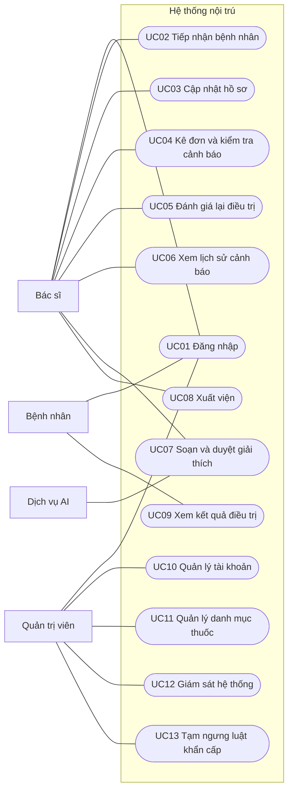
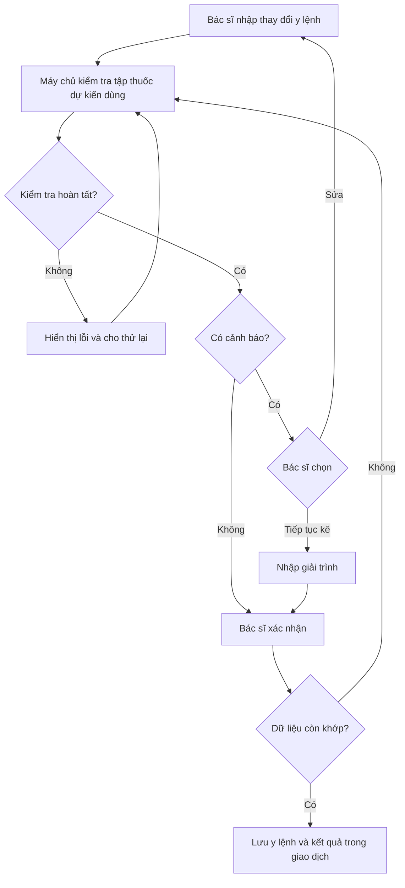
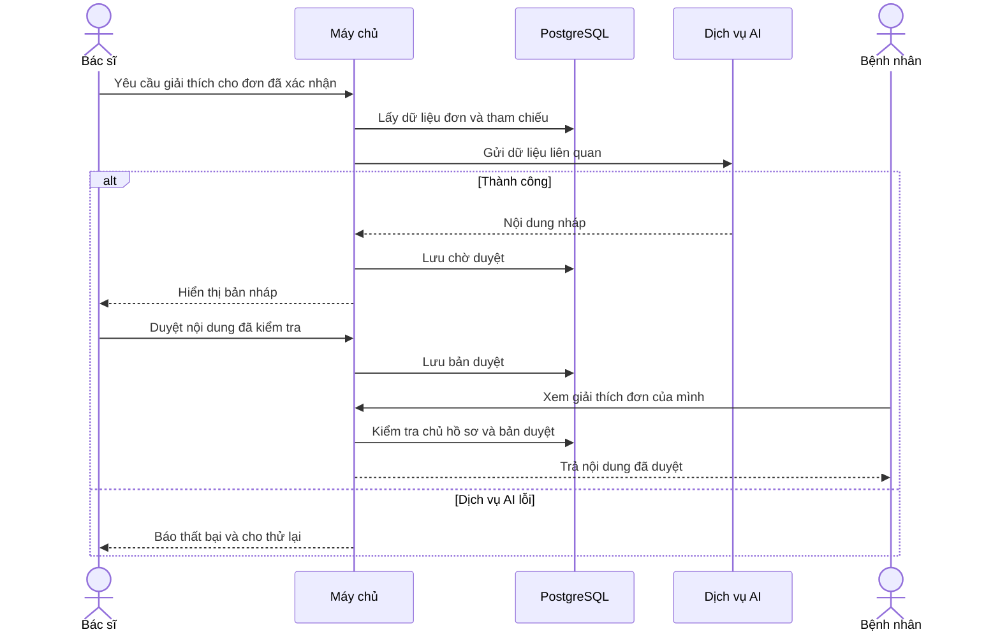
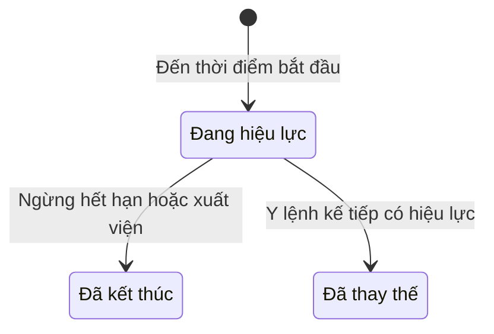
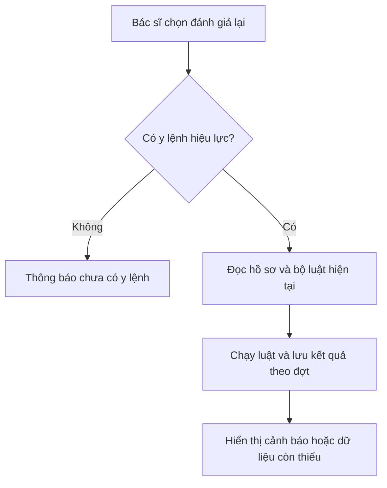
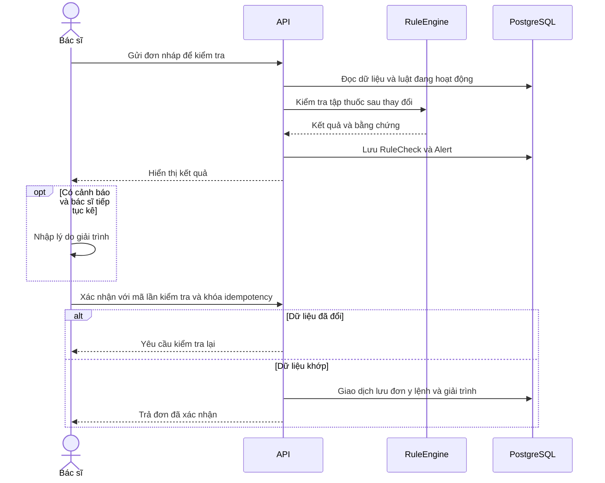
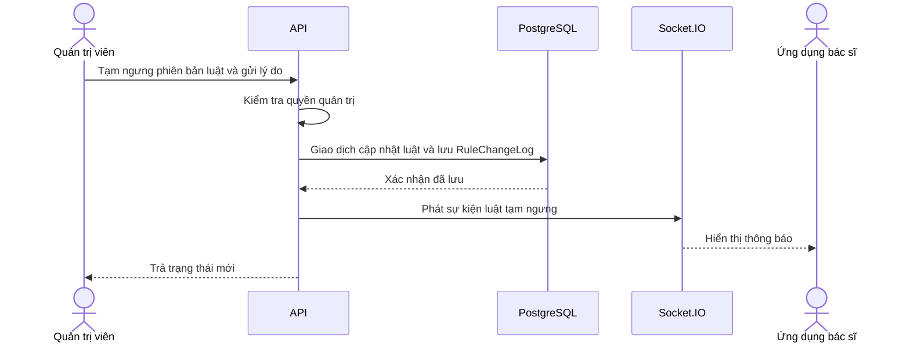

# Phân tích và thiết kế hệ thống DACS4

## 3.1 Giới thiệu và mục tiêu

**Đề tài:** Xây dựng ứng dụng Client–Server hỗ trợ kê đơn và cảnh giác dược cho bác sĩ điều trị nội trú. Phạm vi thí điểm gồm tăng huyết áp và đái tháo đường típ 2, sử dụng dữ liệu bệnh nhân mô phỏng. Hệ thống quản lý từ nhập viện, chẩn đoán và kê đơn đến xuất viện. Bộ luật hỗ trợ phát hiện chống chỉ định, tương tác và nguy cơ quá liều theo cân nặng. Bác sĩ quyết định điều trị. AI diễn giải đơn đã xác nhận từ dữ liệu tham chiếu đã kiểm tra. Bác sĩ duyệt nội dung trước khi bệnh nhân xem.

Căn cứ phạm vi là đề cương Đồ án cơ sở 4 của Lê Nhuận Phát. Bố cục tham khảo báo cáo thực tập thực tế và tài liệu phân tích hệ thống web game cờ vua. 
## 3.2 Yêu cầu chức năng và tác nhân

| Mã | Tác nhân | Kết quả |
|---|---|---|
| UC01 | Bác sĩ, Bệnh nhân, Quản trị viên | Đăng nhập và nhận JWT theo vai trò. Bác sĩ và quản trị viên dùng tên đăng nhập/mật khẩu, bệnh nhân dùng mã bệnh nhân theo đề cương. |
| UC02 | Bác sĩ | Tra cứu hoặc tạo hồ sơ, cấp mã bệnh nhân khi tiếp nhận lần đầu, mở đợt điều trị. |
| UC03 | Bác sĩ | Cập nhật tiền sử, bệnh nền, dị ứng, thuốc đang dùng, chẩn đoán, sinh hiệu và xét nghiệm. |
| UC04 | Bác sĩ | Kiểm tra và xác nhận kê đơn, bổ sung, thay đổi hoặc ngừng y lệnh. |
| UC05 | Bác sĩ | Đánh giá lại các y lệnh đang có hiệu lực theo dữ liệu hiện tại. |
| UC06 | Bác sĩ | Tra cứu kết quả kiểm tra, cảnh báo và giải trình. |
| UC07 | Bác sĩ, dịch vụ AI | Soạn, xem, chỉnh sửa và duyệt nội dung giải thích cho đơn đã xác nhận. |
| UC08 | Bác sĩ | Ghi thời điểm xuất viện và đóng đợt điều trị. |
| UC09 | Bệnh nhân | Chỉ đọc chẩn đoán, đơn đã xác nhận, tư vấn và giải thích đã duyệt của mình. |
| UC10 | Quản trị viên | Quản lý tài khoản bác sĩ và bệnh nhân. |
| UC11 | Quản trị viên | Quản lý danh mục thuốc. |
| UC12 | Quản trị viên | Giám sát hồ sơ, đơn và lịch sử cảnh báo ở chế độ chỉ đọc. |
| UC13 | Quản trị viên | Tạm ngưng luật khẩn cấp, ghi lý do và thông báo qua Socket.IO. |

Dữ liệu bệnh nền, dị ứng và thuốc được chọn theo mã danh mục. Sinh hiệu và xét nghiệm định lượng lưu giá trị, đơn vị, thời điểm đo. Tiền sử thuộc hồ sơ bệnh nhân. Chẩn đoán, chỉ số, y lệnh và tư vấn gắn với đợt điều trị.

## 3.3 Yêu cầu phi chức năng

- Máy chủ xác thực JWT, phân quyền theo vai trò và kiểm tra phạm vi bản ghi. Băm mật khẩu bằng bcrypt. API bệnh nhân lấy danh tính từ phiên xác thực.
- Máy chủ phân biệt kết quả không có cảnh báo, thiếu dữ liệu đối chiếu và lỗi chạy bộ luật. Giữ lịch sử của các lần kiểm tra, kể cả lần không có cảnh báo.
- Kiểm tra lại khi nội dung y lệnh, hồ sơ liên quan hoặc bộ luật thay đổi trước lúc xác nhận. Ghi nhận đơn, thay đổi y lệnh và giải trình trong cùng giao dịch. Yêu cầu gửi lặp trả kết quả đã ghi nhận.
- Lưu bằng chứng và phiên bản luật tại thời điểm kiểm tra. Sau khi kết nối lại, ứng dụng lấy trạng thái hiện tại từ REST API.
- Dịch vụ AI có trạng thái thất bại và có thể thử lại. Máy chủ gửi payload ẩn danh theo danh sách trường cho phép: thuốc, cách dùng và trích đoạn tham chiếu cần thiết. Loại tên, mã bệnh nhân, mã hồ sơ, địa chỉ, ngày sinh và ghi chú tự do. Chỉ công bố bản được bác sĩ duyệt.

## 3.4 Mô hình Use Case

### UC01 Đăng nhập

**Tiền điều kiện.** Tài khoản đang hoạt động.

**Luồng chính và kết quả.** Người dùng nhập thông tin theo vai trò. API xác thực và cấp JWT.

**Luồng ngoại lệ.** Thông tin sai hoặc tài khoản vô hiệu hóa thì từ chối.

### UC02 Tiếp nhận bệnh nhân

Bác sĩ đã đăng nhập tìm bệnh nhân theo mã hoặc thông tin hành chính. Nếu chưa có hồ sơ, bác sĩ nhập dữ liệu bắt buộc và máy chủ cấp mã duy nhất. Bác sĩ chọn hồ sơ để mở đợt điều trị. Máy chủ ghi người tiếp nhận, thời điểm nhập viện và trả về hồ sơ đợt điều trị. Nếu dữ liệu thiếu, giao diện chỉ rõ trường cần bổ sung.

### UC03 Cập nhật hồ sơ

**Tiền điều kiện.** Bác sĩ có quyền trên đợt đang mở.

**Luồng chính và kết quả.** Bác sĩ chọn mục, nhập dữ liệu, máy chủ kiểm tra danh mục, giá trị và đơn vị rồi lưu.

**Luồng ngoại lệ.** Dữ liệu không hợp lệ hoặc đợt đã đóng thì trả lỗi.

### UC04 Kê đơn và kiểm tra cảnh báo

1. Bác sĩ có quyền thao tác trong đợt đang mở nhập thuốc, liều, đơn vị, đường dùng, lịch dùng và thời hạn.
2. Khi bác sĩ chọn xác nhận kê đơn, máy chủ kiểm tra danh sách thuốc dự kiến dùng đồng thời sau thay đổi, cùng dữ liệu hồ sơ hiện tại và các luật đang hoạt động.
3. Máy chủ lưu lần kiểm tra và hiển thị cảnh báo cạnh thuốc liên quan. Nếu thiếu dữ liệu, chỉ rõ mục chưa đủ căn cứ. Nếu kiểm tra lỗi, báo chưa hoàn tất và cho thử lại.
4. Bác sĩ chọn **Sửa y lệnh** hoặc **Tiếp tục kê và giải trình** khi có cảnh báo. Nếu tiếp tục, lý do giải trình là bắt buộc. Khi bác sĩ sửa y lệnh hoặc dữ liệu đối chiếu đã thay đổi, máy chủ chạy lại kiểm tra.
5. Máy chủ lưu đơn, y lệnh mới, việc kết thúc các y lệnh bị ngừng hoặc thay thế, người xác nhận, thời điểm, kết quả kiểm tra và giải trình trong cùng giao dịch.

Một đợt điều trị có thể có nhiều y lệnh hiệu lực cùng lúc. Đổi liều một thuốc kết thúc y lệnh cũ của thuốc đó và tạo y lệnh thay thế. Các thuốc khác tiếp tục theo y lệnh hiện có. Lịch sử lưu theo lần kê, danh sách thuốc đang dùng truy vấn theo hiệu lực của từng y lệnh.

### UC05 Đánh giá lại điều trị

Bác sĩ chủ động chọn đánh giá tại mốc nhập viện nếu có y lệnh, khi có diễn biến hoặc xét nghiệm quan trọng, hoặc trước xuất viện. Máy chủ kiểm tra tất cả y lệnh đang có hiệu lực theo dữ liệu mới nhất, lưu và hiển thị kết quả. Nếu chưa có y lệnh hiệu lực, giao diện báo chưa có đối tượng đánh giá. Lưu sinh hiệu hoặc xét nghiệm chỉ cập nhật hồ sơ. Nếu cần đổi thuốc, bác sĩ thực hiện UC04.

### UC06 Xem lịch sử cảnh báo

**Tiền điều kiện.** Bác sĩ có quyền xem đợt điều trị.

**Luồng chính và kết quả.** Chọn đợt và lần kiểm tra. API trả cảnh báo, phiên bản luật, bằng chứng và giải trình đã lưu.

**Luồng ngoại lệ.** Nếu chưa có lần kiểm tra, hiển thị danh sách rỗng.

### UC07 Soạn và duyệt giải thích

Đơn đã xác nhận là đầu vào. Máy chủ lấy chi tiết đơn và dữ liệu tham chiếu đã kiểm tra, gửi đến dịch vụ AI để diễn giải thời điểm dùng, lưu ý và dấu hiệu cần báo lại nếu có trong dữ liệu nguồn. Nội dung ở trạng thái **Chờ duyệt**. Bác sĩ xem, sửa và duyệt. Máy chủ lưu bản duyệt, người duyệt, thời điểm và đơn tương ứng. Khi thay đổi y lệnh, nội dung cho chỉ định mới cần được duyệt theo đơn mới. Dịch vụ AI lỗi thì ghi trạng thái thất bại và cho thử lại.

### UC08 Xuất viện

**Tiền điều kiện.** Bác sĩ có quyền trên đợt đang mở.

**Luồng chính và kết quả.** Bác sĩ xác nhận xuất viện. Máy chủ đóng đợt và kết thúc y lệnh nội trú còn hiệu lực trong cùng giao dịch.

**Luồng ngoại lệ.** Nếu đợt đã đóng, trả trạng thái hiện tại.

### UC09 Xem kết quả điều trị

**Tiền điều kiện.** Bệnh nhân đã đăng nhập.

**Luồng chính và kết quả.** API lấy hồ sơ từ danh tính đã xác thực, trả chẩn đoán được công bố, đơn đã xác nhận, tư vấn và giải thích đã duyệt.

**Luồng ngoại lệ.** API từ chối truy cập hồ sơ khác.

### UC10 Quản lý tài khoản

**Tiền điều kiện.** Quản trị viên đã đăng nhập.

**Luồng chính và kết quả.** Quản trị viên tạo, sửa hoặc vô hiệu hóa tài khoản. API kiểm tra vai trò, trường bắt buộc và tính duy nhất trước khi lưu.

**Luồng ngoại lệ.** Báo lỗi khi mã hoặc tên đăng nhập bị trùng.

### UC11 Quản lý danh mục thuốc

**Tiền điều kiện.** Quản trị viên đã đăng nhập.

**Luồng chính và kết quả.** Quản trị viên cập nhật thuốc và ánh xạ hoạt chất, nhóm dược lý, tác nhân dị ứng. Thuốc đã dùng có thể được đánh dấu ngừng sử dụng để giữ lịch sử.

**Luồng ngoại lệ.** API từ chối mã trùng hoặc ánh xạ đến mục danh mục không tồn tại.

### UC12 Giám sát hệ thống

**Tiền điều kiện.** Quản trị viên đã đăng nhập.

**Luồng chính và kết quả.** Lọc hồ sơ, đơn hoặc lần kiểm tra. API trả dữ liệu chỉ đọc.

**Luồng ngoại lệ.** Yêu cầu sửa dữ liệu nghiệp vụ bằng quyền giám sát bị từ chối.

### UC13 Tạm ngưng luật khẩn cấp

Quản trị viên chọn luật đang hoạt động và nhập lý do. Máy chủ kiểm tra quyền, cập nhật trạng thái và ghi nhật ký. Sau khi lưu thành công, máy chủ phát sự kiện Socket.IO cho các phiên bác sĩ đang kết nối. Bộ máy luật dùng trạng thái lưu trên máy chủ cho lần kiểm tra tiếp theo. Lịch sử cảnh báo giữ căn cứ và phiên bản gốc.

## 3.5 Kiến trúc và mô hình lớp

- Desktop Windows: Electron, React, TypeScript, Vite, Ant Design. Tách tiến trình chính và renderer, bật context isolation, giới hạn IPC.
- Máy chủ: Node.js, Express, TypeScript, Prisma, PostgreSQL. REST xử lý nghiệp vụ, JWT xác thực, Socket.IO thông báo tạm ngưng luật. Rule engine chạy ở máy chủ.
- Tích hợp AI: máy chủ gọi dịch vụ LLM qua HTTPS sau khi xác nhận đơn. Dữ liệu tham chiếu nhập từ Dược thư quốc gia và nguồn được chuyên môn kiểm tra. Rule engine quyết định kết quả cảnh báo theo luật, bác sĩ quyết định kê đơn.
- Đóng gói dự kiến bằng electron-builder. Client cần kết nối tới máy chủ qua mạng nội bộ hoặc Internet để lưu hồ sơ, kê đơn và chạy luật. Dịch vụ AI bên ngoài cần Internet. Git và Postman hỗ trợ phát triển.

```mermaid
classDiagram
    class User {
        uuid id
        string role
        string username
        string passwordHash
        string status
    }
    class Patient {
        uuid id
        uuid userId
        string patientCode
        string fullName
    }
    class Encounter {
        uuid id
        uuid patientId
        uuid doctorId
        timestamptz admittedAt
        timestamptz dischargedAt
        string admissionNote
        int version
    }
    class Disease {
        uuid id
        string code
        string name
    }
    class Allergen {
        uuid id
        string code
        string name
    }
    class Medication {
        uuid id
        string code
        string name
        string strength
        bool active
    }
    class Ingredient {
        uuid id
        string code
        string name
    }
    class DrugGroup {
        uuid id
        string code
        string name
    }
    class MedicationIngredient {
        uuid medicationId
        uuid ingredientId
    }
    class MedicationGroup {
        uuid medicationId
        uuid groupId
    }
    class MedicationAllergen {
        uuid medicationId
        uuid allergenId
    }
    class PatientCondition {
        uuid id
        uuid patientId
        uuid diseaseId
        timestamptz recordedAt
    }
    class PatientAllergy {
        uuid id
        uuid patientId
        uuid allergenId
        timestamptz recordedAt
    }
    class PatientMedication {
        uuid id
        uuid patientId
        uuid medicationId
        timestamptz recordedAt
        timestamptz endedAt
    }
    class Diagnosis {
        uuid id
        uuid encounterId
        uuid diseaseId
        timestamptz diagnosedAt
    }
    class Observation {
        uuid id
        uuid encounterId
        string type
        decimal value
        string unit
        timestamptz measuredAt
    }
    class Prescription {
        uuid id
        uuid encounterId
        uuid doctorId
        string status
        timestamptz confirmedAt
        uuid idempotencyKey
        string requestHash
    }
    class PrescriptionItem {
        uuid id
        uuid prescriptionId
        uuid medicationId
        decimal dose
        string doseUnit
        string route
        jsonb schedule
        timestamptz startedAt
        timestamptz endedAt
        string endReason
        uuid endedBy
        uuid replacesItemId
    }
    class AlertRule {
        uuid id
        string code
        int version
        string category
        jsonb condition
        string message
        string sourceRef
        bool active
    }
    class RuleDisease {
        uuid ruleId
        uuid diseaseId
    }
    class RuleCheck {
        uuid id
        uuid encounterId
        uuid prescriptionId
        string trigger
        uuid requestedBy
        timestamptz checkedAt
        string status
        jsonb contextSnapshot
        string overrideReason
        uuid confirmedBy
        timestamptz confirmedAt
    }
    class Alert {
        uuid id
        uuid ruleCheckId
        uuid ruleId
        string messageSnapshot
        jsonb evidence
    }
    class DrugReference {
        uuid id
        uuid medicationId
        string content
        string sourceRef
        string reviewStatus
    }
    class Explanation {
        uuid id
        uuid prescriptionId
        string status
        string draftContent
        string approvedContent
        uuid approvedBy
        timestamptz approvedAt
    }
    class TreatmentAdvice {
        uuid id
        uuid encounterId
        uuid doctorId
        string content
        timestamptz publishedAt
    }
    class RuleChangeLog {
        uuid id
        uuid ruleId
        uuid changedBy
        bool oldStatus
        bool newStatus
        string reason
        timestamptz changedAt
    }
    User "1" -- "0..1" Patient : userId
    Patient "1" -- "0..*" Encounter : patientId
    User "1" -- "0..*" Encounter : doctorId
    Medication "1" -- "0..*" MedicationIngredient : medicationId
    Ingredient "1" -- "0..*" MedicationIngredient : ingredientId
    Medication "1" -- "0..*" MedicationGroup : medicationId
    DrugGroup "1" -- "0..*" MedicationGroup : groupId
    Medication "1" -- "0..*" MedicationAllergen : medicationId
    Allergen "1" -- "0..*" MedicationAllergen : allergenId
    Patient "1" -- "0..*" PatientCondition : patientId
    Disease "1" -- "0..*" PatientCondition : diseaseId
    Patient "1" -- "0..*" PatientAllergy : patientId
    Allergen "1" -- "0..*" PatientAllergy : allergenId
    Patient "1" -- "0..*" PatientMedication : patientId
    Medication "1" -- "0..*" PatientMedication : medicationId
    Encounter "1" -- "0..*" Diagnosis : encounterId
    Disease "1" -- "0..*" Diagnosis : diseaseId
    Encounter "1" -- "0..*" Observation : encounterId
    Encounter "1" -- "0..*" Prescription : encounterId
    User "1" -- "0..*" Prescription : doctorId
    Prescription "1" -- "0..*" PrescriptionItem : prescriptionId
    Medication "1" -- "0..*" PrescriptionItem : medicationId
    User "0..1" -- "0..*" PrescriptionItem : endedBy
    PrescriptionItem "0..1" -- "0..1" PrescriptionItem : replacesItemId
    AlertRule "1" -- "0..*" RuleDisease : ruleId
    Disease "1" -- "0..*" RuleDisease : diseaseId
    Encounter "1" -- "0..*" RuleCheck : encounterId
    Prescription "0..1" -- "0..*" RuleCheck : prescriptionId
    User "1" -- "0..*" RuleCheck : requestedBy
    User "0..1" -- "0..*" RuleCheck : confirmedBy
    RuleCheck "1" -- "0..*" Alert : ruleCheckId
    AlertRule "1" -- "0..*" Alert : ruleId
    Medication "1" -- "0..*" DrugReference : medicationId
    Prescription "1" -- "0..*" Explanation : prescriptionId
    User "0..1" -- "0..*" Explanation : approvedBy
    Encounter "1" -- "0..*" TreatmentAdvice : encounterId
    User "1" -- "0..*" TreatmentAdvice : doctorId
    AlertRule "1" -- "0..*" RuleChangeLog : ruleId
    User "1" -- "0..*" RuleChangeLog : changedBy
    class RuleEngine {
        evaluate(context, rules)
    }
    RuleEngine ..> AlertRule
    RuleEngine ..> RuleCheck
```

Đơn nháp có thể chưa có dòng thuốc. Lần xác nhận kê thuốc có ít nhất một dòng. Ngừng thuốc có thể thao tác trên y lệnh hiện có và ghi lịch sử riêng.

## 3.6 Mô hình hóa hành vi

Hiệu lực y lệnh được xác định theo thời gian bắt đầu, thời gian kết thúc và lý do kết thúc. Thay đổi hiệu lực của một y lệnh không làm đổi trạng thái xác nhận của đơn lịch sử.

### Hoạt động đánh giá lại

### Trình tự kê đơn và giải trình

### Trình tự tạm ngưng luật

## 3.7 Thiết kế PostgreSQL

| Bảng | Thuộc tính chính |
|---|---|
| `users` | `id` PK, `role`, `username` (tùy chọn), `password_hash` (tùy chọn), `status` |
| `patients` | `id` PK, `user_id` FK → `users`, `patient_code`, `full_name` |
| `encounters` | `id` PK, `patient_id` FK → `patients`, `doctor_id` FK → `users`, `admitted_at`, `discharged_at` (tùy chọn), `admission_note` (tùy chọn), `version` (mặc định 0). Mỗi bệnh nhân có tối đa một đợt chưa xuất viện. |
| `diseases` | `id` PK, `code`, `name` |
| `allergens` | `id` PK, `code`, `name` |
| `medications` | `id` PK, `code`, `name`, `strength`, `active` |
| `ingredients` | `id` PK, `code`, `name` |
| `drug_groups` | `id` PK, `code`, `name` |
| `medication_ingredients` | `medication_id` PK FK → `medications`, `ingredient_id` PK FK → `ingredients` |
| `medication_groups` | `medication_id` PK FK → `medications`, `group_id` PK FK → `drug_groups` |
| `medication_allergens` | `medication_id` PK FK → `medications`, `allergen_id` PK FK → `allergens` |
| `patient_conditions` | `id` PK, `patient_id` FK → `patients`, `disease_id` FK → `diseases`, `recorded_at` |
| `patient_allergies` | `id` PK, `patient_id` FK → `patients`, `allergen_id` FK → `allergens`, `recorded_at` |
| `patient_medications` | `id` PK, `patient_id` FK → `patients`, `medication_id` FK → `medications`, `recorded_at`, `ended_at` (tùy chọn) |
| `diagnoses` | `id` PK, `encounter_id` FK → `encounters`, `disease_id` FK → `diseases`, `diagnosed_at` |
| `observations` | `id` PK, `encounter_id` FK → `encounters`, `type`, `value`, `unit`, `measured_at` |
| `prescriptions` | `id` PK, `encounter_id` FK → `encounters`, `doctor_id` FK → `users`, `status`, `confirmed_at` (tùy chọn), `idempotency_key` (tùy chọn), `request_hash` (tùy chọn) |
| `prescription_items` | `id` PK, `prescription_id` FK → `prescriptions`, `medication_id` FK → `medications`, `dose`, `dose_unit`, `route`, `schedule`, `started_at`, `ended_at` (tùy chọn), `end_reason` (tùy chọn), `ended_by` FK → `users` (tùy chọn), `replaces_item_id` FK → `prescription_items` (tùy chọn) |
| `alert_rules` | `id` PK, `code`, `version`, `category`, `condition`, `message`, `source_ref`, `active` |
| `rule_diseases` | `rule_id` PK FK → `alert_rules`, `disease_id` PK FK → `diseases` |
| `rule_checks` | `id` PK, `encounter_id` FK → `encounters`, `prescription_id` FK → `prescriptions` (tùy chọn), `trigger`, `requested_by` FK → `users`, `checked_at`, `status`, `context_snapshot`, `override_reason` (tùy chọn), `confirmed_by` FK → `users` (tùy chọn), `confirmed_at` (tùy chọn) |
| `alerts` | `id` PK, `rule_check_id` FK → `rule_checks`, `rule_id` FK → `alert_rules`, `message_snapshot`, `evidence` |
| `drug_references` | `id` PK, `medication_id` FK → `medications`, `content`, `source_ref`, `review_status` |
| `explanations` | `id` PK, `prescription_id` FK → `prescriptions`, `status`, `draft_content` (tùy chọn), `approved_content` (tùy chọn), `approved_by` FK → `users` (tùy chọn), `approved_at` (tùy chọn) |
| `treatment_advice` | `id` PK, `encounter_id` FK → `encounters`, `doctor_id` FK → `users`, `content`, `published_at` (tùy chọn) |
| `rule_change_logs` | `id` PK, `rule_id` FK → `alert_rules`, `changed_by` FK → `users`, `old_status`, `new_status`, `reason`, `changed_at` |

### Sơ đồ quan hệ thực thể

```mermaid
erDiagram
    USERS {
        uuid id PK
        string role
        string username "nullable"
        string password_hash "nullable"
        string status
    }
    PATIENTS {
        uuid id PK
        uuid user_id FK
        string patient_code
        string full_name
    }
    ENCOUNTERS {
        uuid id PK
        uuid patient_id FK
        uuid doctor_id FK
        timestamptz admitted_at
        timestamptz discharged_at "nullable"
        string admission_note "nullable"
        int version
    }
    DISEASES {
        uuid id PK
        string code
        string name
    }
    ALLERGENS {
        uuid id PK
        string code
        string name
    }
    MEDICATIONS {
        uuid id PK
        string code
        string name
        string strength
        bool active
    }
    INGREDIENTS {
        uuid id PK
        string code
        string name
    }
    DRUG_GROUPS {
        uuid id PK
        string code
        string name
    }
    MEDICATION_INGREDIENTS {
        uuid medication_id PK, FK
        uuid ingredient_id PK, FK
    }
    MEDICATION_GROUPS {
        uuid medication_id PK, FK
        uuid group_id PK, FK
    }
    MEDICATION_ALLERGENS {
        uuid medication_id PK, FK
        uuid allergen_id PK, FK
    }
    PATIENT_CONDITIONS {
        uuid id PK
        uuid patient_id FK
        uuid disease_id FK
        timestamptz recorded_at
    }
    PATIENT_ALLERGIES {
        uuid id PK
        uuid patient_id FK
        uuid allergen_id FK
        timestamptz recorded_at
    }
    PATIENT_MEDICATIONS {
        uuid id PK
        uuid patient_id FK
        uuid medication_id FK
        timestamptz recorded_at
        timestamptz ended_at "nullable"
    }
    DIAGNOSES {
        uuid id PK
        uuid encounter_id FK
        uuid disease_id FK
        timestamptz diagnosed_at
    }
    OBSERVATIONS {
        uuid id PK
        uuid encounter_id FK
        string type
        decimal value
        string unit
        timestamptz measured_at
    }
    PRESCRIPTIONS {
        uuid id PK
        uuid encounter_id FK
        uuid doctor_id FK
        string status
        timestamptz confirmed_at "nullable"
        uuid idempotency_key "nullable"
        string request_hash "nullable"
    }
    PRESCRIPTION_ITEMS {
        uuid id PK
        uuid prescription_id FK
        uuid medication_id FK
        decimal dose
        string dose_unit
        string route
        jsonb schedule
        timestamptz started_at
        timestamptz ended_at "nullable"
        string end_reason "nullable"
        uuid ended_by FK "nullable"
        uuid replaces_item_id FK "nullable"
    }
    ALERT_RULES {
        uuid id PK
        string code
        int version
        string category
        jsonb condition
        string message
        string source_ref
        bool active
    }
    RULE_DISEASES {
        uuid rule_id PK, FK
        uuid disease_id PK, FK
    }
    RULE_CHECKS {
        uuid id PK
        uuid encounter_id FK
        uuid prescription_id FK "nullable"
        string trigger
        uuid requested_by FK
        timestamptz checked_at
        string status
        jsonb context_snapshot
        string override_reason "nullable"
        uuid confirmed_by FK "nullable"
        timestamptz confirmed_at "nullable"
    }
    ALERTS {
        uuid id PK
        uuid rule_check_id FK
        uuid rule_id FK
        string message_snapshot
        jsonb evidence
    }
    DRUG_REFERENCES {
        uuid id PK
        uuid medication_id FK
        string content
        string source_ref
        string review_status
    }
    EXPLANATIONS {
        uuid id PK
        uuid prescription_id FK
        string status
        string draft_content "nullable"
        string approved_content "nullable"
        uuid approved_by FK "nullable"
        timestamptz approved_at "nullable"
    }
    TREATMENT_ADVICE {
        uuid id PK
        uuid encounter_id FK
        uuid doctor_id FK
        string content
        timestamptz published_at "nullable"
    }
    RULE_CHANGE_LOGS {
        uuid id PK
        uuid rule_id FK
        uuid changed_by FK
        bool old_status
        bool new_status
        string reason
        timestamptz changed_at
    }
    USERS ||--o| PATIENTS : user_id
    PATIENTS ||--o{ ENCOUNTERS : patient_id
    USERS ||--o{ ENCOUNTERS : doctor_id
    MEDICATIONS ||--o{ MEDICATION_INGREDIENTS : medication_id
    INGREDIENTS ||--o{ MEDICATION_INGREDIENTS : ingredient_id
    MEDICATIONS ||--o{ MEDICATION_GROUPS : medication_id
    DRUG_GROUPS ||--o{ MEDICATION_GROUPS : group_id
    MEDICATIONS ||--o{ MEDICATION_ALLERGENS : medication_id
    ALLERGENS ||--o{ MEDICATION_ALLERGENS : allergen_id
    PATIENTS ||--o{ PATIENT_CONDITIONS : patient_id
    DISEASES ||--o{ PATIENT_CONDITIONS : disease_id
    PATIENTS ||--o{ PATIENT_ALLERGIES : patient_id
    ALLERGENS ||--o{ PATIENT_ALLERGIES : allergen_id
    PATIENTS ||--o{ PATIENT_MEDICATIONS : patient_id
    MEDICATIONS ||--o{ PATIENT_MEDICATIONS : medication_id
    ENCOUNTERS ||--o{ DIAGNOSES : encounter_id
    DISEASES ||--o{ DIAGNOSES : disease_id
    ENCOUNTERS ||--o{ OBSERVATIONS : encounter_id
    ENCOUNTERS ||--o{ PRESCRIPTIONS : encounter_id
    USERS ||--o{ PRESCRIPTIONS : doctor_id
    PRESCRIPTIONS ||--o{ PRESCRIPTION_ITEMS : prescription_id
    MEDICATIONS ||--o{ PRESCRIPTION_ITEMS : medication_id
    USERS o|--o{ PRESCRIPTION_ITEMS : ended_by
    PRESCRIPTION_ITEMS o|--o| PRESCRIPTION_ITEMS : replaces_item_id
    ALERT_RULES ||--o{ RULE_DISEASES : rule_id
    DISEASES ||--o{ RULE_DISEASES : disease_id
    ENCOUNTERS ||--o{ RULE_CHECKS : encounter_id
    PRESCRIPTIONS o|--o{ RULE_CHECKS : prescription_id
    USERS ||--o{ RULE_CHECKS : requested_by
    USERS o|--o{ RULE_CHECKS : confirmed_by
    RULE_CHECKS ||--o{ ALERTS : rule_check_id
    ALERT_RULES ||--o{ ALERTS : rule_id
    MEDICATIONS ||--o{ DRUG_REFERENCES : medication_id
    PRESCRIPTIONS ||--o{ EXPLANATIONS : prescription_id
    USERS o|--o{ EXPLANATIONS : approved_by
    ENCOUNTERS ||--o{ TREATMENT_ADVICE : encounter_id
    USERS ||--o{ TREATMENT_ADVICE : doctor_id
    ALERT_RULES ||--o{ RULE_CHANGE_LOGS : rule_id
    USERS ||--o{ RULE_CHANGE_LOGS : changed_by
```

- Mỗi cặp mã luật và phiên bản là duy nhất. Thay đổi điều kiện chuyên môn tạo phiên bản mới.
- Y lệnh thay thế tham chiếu y lệnh cũ cùng đợt điều trị. Kiểm tra hiệu lực theo mốc thời gian để xây dựng tập thuốc dùng đồng thời.
- Lần đánh giá toàn đợt có thể liên kết trực tiếp với đợt điều trị. Lần kiểm tra khi xác nhận lưu kèm đơn và ảnh chụp dữ liệu sử dụng.
- Lý do tiếp tục kê phải gắn với đúng kết quả cảnh báo bác sĩ đã xem. Ghi lại người và thời điểm xác nhận.
- API bệnh nhân chỉ trả bản duyệt thuộc hồ sơ đã xác thực. Nhật ký và bằng chứng cảnh báo được giữ khi tạm ngưng luật.

### Ràng buộc xác nhận và giải trình

- `rule_checks.override_reason` bắt buộc có nội dung khi xác nhận tiếp với lần kiểm tra có cảnh báo. Cùng giao dịch, lưu `confirmed_by`, `confirmed_at` và liên kết tới đơn. Các cảnh báo bác sĩ đã xem được truy lại qua `alerts.rule_check_id`.
- Client tạo `idempotency_key` cho mỗi yêu cầu xác nhận và giữ khóa khi gửi lại. Ràng buộc duy nhất theo `doctor_id` và `idempotency_key`. API so sánh `request_hash` của nội dung đã chuẩn hóa. Cùng khóa và cùng nội dung trả đơn đã xác nhận, khác nội dung trả HTTP 409. Ràng buộc duy nhất và giao dịch xử lý yêu cầu đồng thời.
- `prescription_items.replaces_item_id` duy nhất khi có giá trị, tham chiếu dòng cũ trong cùng đợt. Khi thay thế, `ended_at` của dòng cũ bằng `started_at` của dòng mới. `end_reason` dùng `STOPPED`, `EXPIRED`, `DISCHARGED` hoặc `REPLACED` tùy nghiệp vụ. Hiệu lực tại thời điểm t được tính theo khoảng bắt đầu bao gồm, kết thúc loại trừ. Hạn dùng theo lịch đã kê được kiểm tra khi xác định hiệu lực.
- Mã trong danh mục và cặp `alert_rules(code, version)` là duy nhất. Các bảng ánh xạ dùng khóa chính ghép. `patients.user_id` duy nhất.

## 3.8 Thiết kế bộ máy luật

`alert_rules.condition` là JSONB theo cấu trúc có phiên bản và danh sách loại điều kiện cho phép. Máy chủ kiểm tra kiểu, đơn vị và mã danh mục khi nhập luật. Bộ máy luật chọn hàm đánh giá theo loại điều kiện. Mỗi lần chạy có kết quả khớp, không khớp hoặc thiếu dữ liệu cho từng luật. Lỗi thực thi được ghi riêng. `rule_diseases` khai báo bệnh thí điểm áp dụng. Không có dòng liên kết nghĩa là luật dùng chung. Nếu có nhiều bệnh áp dụng, chỉ cần một mã xuất hiện trong chẩn đoán hoặc bệnh nền. Bệnh làm điều kiện chống chỉ định được khai báo riêng trong JSON.

Đối chiếu thuốc theo mã danh mục, hoạt chất hoặc nhóm dược lý qua các bảng ánh xạ. Dị ứng đối chiếu giữa `patient_allergies` và `medication_allergens`. Luật theo cân nặng đọc bản ghi `observations` mới nhất có `type = WEIGHT`, đơn vị chuẩn kg, thuộc đợt hiện tại và có thời điểm đo không muộn hơn lúc kiểm tra. Khi thiếu cân nặng hoặc không quy đổi được liều sang cùng đơn vị, trả thiếu dữ liệu. Khi tính tổng lượng dùng theo ngày, cộng các y lệnh hiệu lực có cùng hoạt chất nếu luật yêu cầu.

Các mẫu dưới đây dùng mã giả và chỉ minh họa cấu trúc kiểm thử phần mềm. Giá trị ngưỡng và nội dung áp dụng thực tế cần nguồn tham chiếu và duyệt chuyên môn theo đề cương.

| Ví dụ | JSONB minh họa | Kết quả |
|---|---|---|
| Chống chỉ định theo bệnh nền và nhóm | `{"schemaVersion":1,"type":"DISEASE_GROUP","diseaseCode":"DEMO_DISEASE","groupCode":"DEMO_GROUP"}` | Cảnh báo khi có bệnh nền và thuốc thuộc nhóm tương ứng. |
| Tương tác giữa hoạt chất | `{"schemaVersion":1,"type":"INGREDIENT_PAIR","ingredientCodes":["DEMO_A","DEMO_B"]}` | Cảnh báo khi cả hai hoạt chất xuất hiện trong tập thuốc dự kiến dùng đồng thời. |
| Giới hạn theo cân nặng | `{"schemaVersion":1,"type":"WEIGHT_LIMIT","ingredientCode":"DEMO_A","maxMgPerKgPerDay":1}` | Fixture mô phỏng so tổng mg/ngày chia cân nặng kg với ngưỡng giả định. |

## 3.9 Nguồn tham khảo và phạm vi triển khai

Đề cương ĐACS4 là căn cứ chọn Electron, React, Node.js, PostgreSQL, Socket.IO và AI. Có thể triển khai theo thứ tự hồ sơ, kê đơn và cảnh báo, sau đó tạm ngưng luật và giải thích AI.

Tham khảo nghiệp vụ chỉ định và sử dụng thuốc theo Điều 3 và Điều 4 của [Thông tư 23/2011/TT-BYT trên Công báo Chính phủ](https://congbao.chinhphu.vn/van-ban/thong-tu-so-23-2011-tt-byt-11566.htm).
